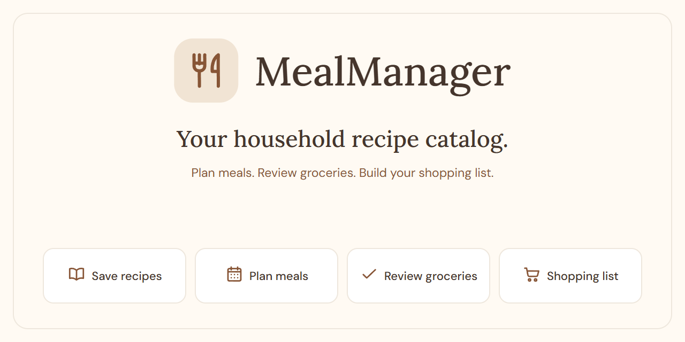

<p align="center">
  
</p>

# MealManager

Self-hosted recipes, meal plans, and shopping lists for one household.

[](https://github.com/rdegroot1996/mealmanager/actions/workflows/docker-publish.yml)
[](LICENSE)

## 🍽️ Recipes, meal plans, and shopping

- **Save and organize recipes.** Keep ingredients, steps, photos, and notes in a searchable catalog with categories, tags, and favorites. Include ready-made options too.
- **Plan meals and leftovers.** Arrange meals over flexible planning cycles, with day notes for other plans.
- **Review groceries.** Save serving sizes and grocery defaults in recipe profiles, then adjust what you need for each planned meal.
- **Manage your shopping list.** Combine meal groceries with extra items, check off purchases, and add selected products to your supermarket cart—for example, [Picnic](docs/picnic.md).
- **Cook from your recipes.** Follow ingredients and steps in cooking mode, with quantities scaled to your chosen servings.
- **Share with your household.** Individual accounts, mobile and desktop layouts, and multiple languages. Optional [MCP tools](docs/mcp-clients.md) let your AI client manage recipes, meal plans, and shopping lists.

## 🚀 Run with Docker

One container serves Angular and ASP.NET Core, with SQLite and local photo storage.

Copy [docker-compose.example.yml](docker-compose.example.yml) to `docker-compose.yml`, choose the connection settings in its comments, then run:

```powershell
docker compose up -d
```

Open your configured address and create the first administrator. Persist `/app/data` and use HTTPS for normal deployment. See [deployment and backup](docs/deployment.md) for details.

## Documentation

- [Product behavior and terminology](docs/functional-overview.md)
- [Technical guide](docs/README.md)
- [Local development](docs/development.md) · [Frontend and mock API](src/MealManager.App/README.md)
- [Open work](docs/TODO.md)
- [Contributing](CONTRIBUTING.md) · [Security](SECURITY.md)

[Apache License 2.0](LICENSE).
